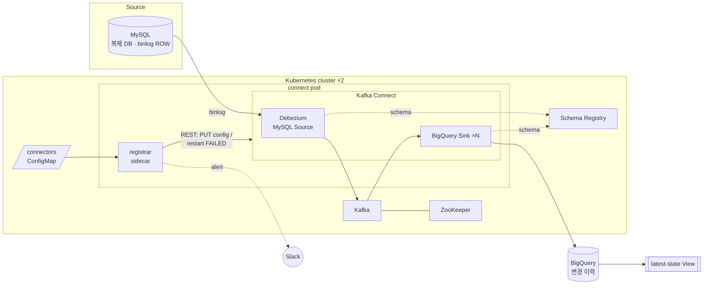

# MySQL CDC → Kafka → BigQuery on Kubernetes

Debezium 으로 MySQL binlog 를 읽어 Kafka 에 변경 이벤트를 발행하고, BigQuery Sink Connector 로
분석 DW(BigQuery)에 실시간 적재하는 파이프라인입니다. GKE 두 개 클러스터에서 여러 서비스 DB 의
수백 개 테이블을 운영했던 구성을 공개용으로 재정리했습니다.
(회사 고유 정보·인증정보는 모두 제거하고 가상의 샘플 스키마로 대체)



## 핵심 설계

- **선언형 커넥터 관리 (registrar sidecar)**: 커넥터 목록을 YAML 로 선언하고, Connect 파드 옆의 sidecar 가
  주기적으로 실제 상태와 비교해 없는 커넥터는 만들고, 수동으로 바뀐 설정은 되돌리고, `FAILED` 태스크는
  재시작하며 Slack 으로 알립니다. Kafka 가 재기동돼 Connect 내부 토픽이 비어도 스스로 복구됩니다.
- **설정은 ConfigMap, 이미지는 불변**: 테이블을 추가해도 이미지 재빌드나 Connect 파드 재시작이 필요 없습니다.
  ConfigMap 이 갱신되면 registrar 가 다음 주기에 변경분만 반영합니다.
- **공통 설정 + 클러스터별 설정 분리**: `defaults.yaml`·`sinks.yaml`(공통)과 클러스터별 `sources.yaml` 을
  registrar 가 병합합니다. kustomize overlay 로 클러스터를 추가합니다.
- **2개 클러스터 이중화**: 같은 복제 DB 를 두 클러스터가 각각 읽어(서로 다른 `server.id`) 한쪽 장애 시에도
  적재가 이어집니다. 중복 적재되는 이벤트는 BigQuery 뷰에서 binlog 위치 기준으로 1건만 남깁니다.
- **복제 DB 를 소스로 사용**: 서비스 master 대신 read replica 의 binlog 를 읽어 운영 DB 부하와 장애 전파를 차단합니다.
- **Avro + Schema Registry**: 소스 테이블 컬럼 추가가 `autoUpdateSchemas` 로 BigQuery 스키마에 자동 반영됩니다.
- **Append-only 변경 이력 + 현재 상태 View**: Debezium envelope(before/after/op)을 그대로 쌓고, 최신 상태는
  `ROW_NUMBER()` 뷰로 제공합니다 → [`sql/bq_latest_state_view.sql`](sql/bq_latest_state_view.sql)
- **인증정보 분리**: DB 비밀번호는 Kafka Connect `FileConfigProvider` 로 Secret 파일을 참조(`${file:...}`)하므로
  registrar 설정이나 REST 요청에 평문으로 나타나지 않습니다.

## 디렉터리

```
registrar/                 선언형 커넥터 동기화 도구 (Python, sidecar 이미지)
config/connectors.yaml     로컬용 커넥터 선언
k8s/base/                  ZooKeeper · Kafka · Schema Registry · Connect(+registrar) + 공통 커넥터 선언
k8s/overlays/cluster-*/    클러스터별 소스 커넥터와 환경값
docker/Dockerfile.connect  Debezium Connect + BigQuery sink 플러그인 이미지
local/                     로컬 검증용 docker compose + 샘플 MySQL 스키마
sql/                       BigQuery 현재 상태 뷰 예시
tests/                     설정 검증 · reconcile 로직 테스트 (가짜 Connect REST 서버 사용)
.github/workflows/ci.yml   lint · test · 선언 파일 검증 · kustomize build · 이미지 빌드
```

## 커넥터 선언 형식

```yaml
defaults:
  source: { connector.class: io.debezium.connector.mysql.MySqlConnector, ... }
  sink:   { connector.class: com.wepay.kafka.connect.bigquery.BigQuerySinkConnector,
            project: ${env:GCP_PROJECT}, ... }
sources:
  - name: mysql-source-shop
    config: { database.hostname: mysql, database.server.id: 184054, database.include.list: shop }
sinks:
  config: { datasets: .*=${env:BQ_DATASET} }
  topics: [customers, orders, products]     # 토픽마다 bq-sink-<topic> 커넥터 생성
  overrides:
    orders: { tasks.max: 2 }
```

registrar 는 적용 전에 다음을 검사합니다: 설정 키의 비-ASCII·공백 문자(예: 복사 과정에서 섞인
zero-width space), 같은 MySQL 호스트에 대한 `server.id` 중복, 커넥터 이름 중복, 누락된 환경변수.
소스마다 schema history 토픽도 자동으로 분리합니다.

## 빠른 시작 (로컬)

```bash
mkdir -p secrets/mysql secrets/gcp
cp config/mysql.properties.example secrets/mysql/mysql.properties   # 샘플 비밀번호 change-me

cd local && docker compose up -d --build
docker compose logs -f registrar      # 소스 커넥터가 자동 등록되는 것 확인
```

변경 이벤트 확인:

```bash
docker compose exec schema-registry \
  kafka-avro-console-consumer --bootstrap-server kafka:9092 --topic orders \
  --from-beginning --property schema.registry.url=http://localhost:8081

# 다른 터미널에서
docker compose exec mysql mysql -uroot -proot shop -e "UPDATE orders SET status='PAID' WHERE id=1;"
```

BigQuery 까지 보려면 `secrets/gcp/credentials.json` 에 서비스 계정 키(BigQuery Data Editor)를 두고
`GCP_PROJECT=... BQ_DATASET=... REGISTRAR_ONLY= docker compose up -d` 로 다시 올립니다.

## registrar CLI

```bash
cd registrar && pip install -r requirements.txt
export CONNECT_URL=http://localhost:8083

python -m registrar validate --config ../config/connectors.yaml
python -m registrar apply    --config ../config/connectors.yaml --dry-run   # 무엇이 바뀌는지만 출력
python -m registrar apply    --config ../config/connectors.yaml [--prune]   # 선언에 없는 커넥터 삭제
python -m registrar status                                                  # FAILED 가 있으면 exit 1
python -m registrar restart-failed
python -m registrar reconcile --loop --interval 60                          # sidecar 모드
```

## Kubernetes 배포

```bash
# 1) 이미지
docker build -f docker/Dockerfile.connect -t <REGISTRY>/cdc-connect:1.4 .
docker build -t <REGISTRY>/cdc-registrar:1.0.0 registrar
docker push <REGISTRY>/cdc-connect:1.4 && docker push <REGISTRY>/cdc-registrar:1.0.0
#    → k8s/base/kustomization.yaml 의 images 수정

# 2) Secret (클러스터마다)
kubectl create namespace cdc
kubectl -n cdc create secret generic gcp-sa-key --from-file=credentials.json=<SA키.json>
kubectl -n cdc create secret generic mysql-cred --from-file=mysql.properties=secrets/mysql/mysql.properties
kubectl -n cdc create secret generic slack-webhook --from-literal=url=<Incoming Webhook URL>   # 선택

# 3) 배포 — 커넥터는 registrar 가 자동 등록
kubectl apply -k k8s/overlays/cluster-a
```

소스 DB 에는 `binlog_format=ROW`, `binlog_row_image=FULL` 과 Debezium 전용 계정
(`SELECT, RELOAD, SHOW DATABASES, REPLICATION SLAVE, REPLICATION CLIENT`)이 필요합니다.

## 발전 과정

운영하면서 두 단계로 구조가 바뀌었고, 공개용으로 정리하며 한 번 더 개선했습니다.

| | v1 | v2 | 이 저장소 |
|---|---|---|---|
| 커넥터 정의 | 커넥터마다 복사한 curl 블록 (셸) | YAML 선언 + 공통 기본값 병합 (Python) | 동일 + 공통/클러스터별 파일 병합 |
| 등록 방식 | 사람이 스크립트 실행 | 파드 `postStart` 에서 1회 `POST` | sidecar 가 주기적으로 비교 후 `PUT` (idempotent) |
| 설정 변경 반영 | 스크립트 재실행 | 이미지 재빌드 + 파드 재배포 | ConfigMap 수정만 (재시작 없음) |
| 장애 감지 | 수동 확인 | 커넥터 **개수** 비교 liveness → 파드 재시작 | 태스크 `FAILED` 감지 → 해당 태스크만 재시작 + 알림 |
| 멀티 클러스터 | 스크립트 수동 수정 | 클러스터별 매니페스트 디렉터리 복제 | kustomize base/overlay |
| 배포 | 수동 | Bitbucket Pipelines CI/CD | GitHub Actions CI |
| 인증정보 | 평문 | 평문 (DB, Slack 토큰) | FileConfigProvider + Secret |
| Connect 이미지 | jar 수십 MB 커밋 | Python 3.8 을 소스 빌드해 Connect 이미지에 포함 | 플러그인은 빌드 시 다운로드, Python 은 별도 sidecar 이미지 |

그 밖에 바로잡은 것:

- v1 일부 설정 키에 zero-width space(U+200B)가 섞여 Connect 가 해당 옵션을 조용히 무시하고 있었음 → 키 정리 + registrar 에서 사전 차단
- `include.schema.events` 는 Debezium 에 없는 키(정확히는 `include.schema.changes`)라 무시되고 있었음
- 여러 소스 커넥터가 schema history 토픽 하나를 공유 → 커넥터별 토픽으로 분리
- Kafka / ZooKeeper 영속 볼륨 없음 → `volumeClaimTemplates` 추가
- ZooKeeper 기반 Schema Registry 저장소 설정(deprecated) → bootstrap servers 방식

## 운영 포인트

- **스냅샷 전략**: 대형 테이블이 많은 DB 는 `initial` 스냅샷 부담이 커서 `schema_only` 로 시작해 이후 변경분만 스트리밍했습니다.
- **`server.id`**: 같은 MySQL 에 붙는 커넥터끼리 겹치면 복제 연결을 서로 끊습니다. 이중화 클러스터는 서로 다른 값을 씁니다.
- **싱크 옵션 호환성**: `insert.mode=upsert` 같은 JDBC 싱크용 옵션은 BigQuery 싱크(1.6)에서 무시됩니다. 그래서 append + 뷰 방식을 사용합니다.

## 개선 여지

- 단일 브로커/단일 ZooKeeper → 3 브로커 + replication factor 3, 또는 Strimzi Operator(`KafkaConnector` CRD 가 registrar 역할을 대체)
- Debezium 1.4 / BigQuery connector 1.6 → Debezium 2.x(KRaft), BigQuery connector 2.x 의 upsert/delete 지원 검토
- registrar 에 Prometheus 메트릭 노출

## License

MIT. `k8s/base` 의 Kafka 관련 매니페스트는 Google Cloud 의 Kafka-on-GKE 샘플(Apache-2.0)을 기반으로 수정했습니다.
